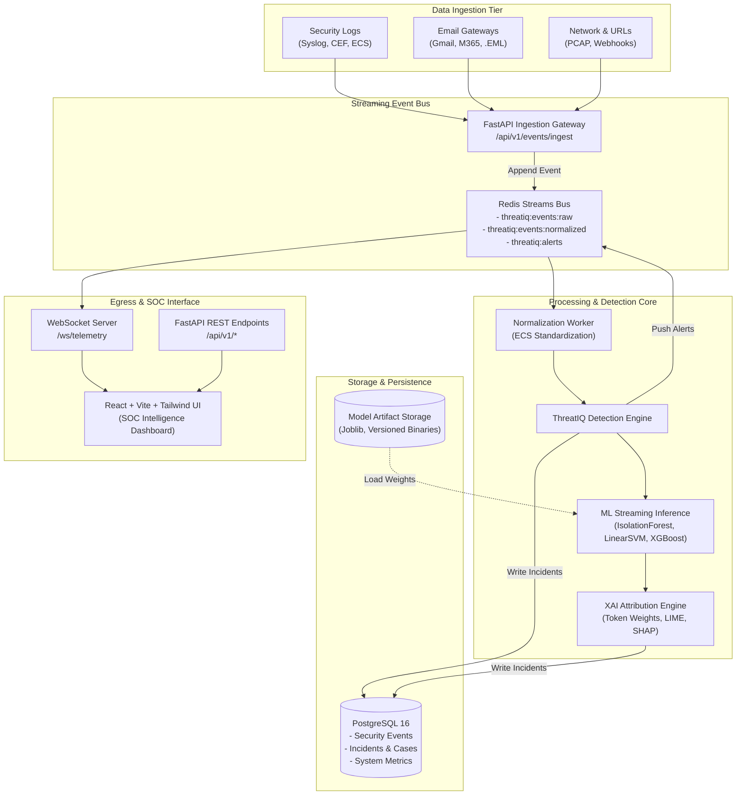

# 🛡️ ThreatIQ — Unified AI-Powered Cybersecurity Detection & SOC Intelligence Platform

<p align="center">
  
  
  
  
  
  
  
</p>

---

## 📌 Executive Overview

**ThreatIQ** is an enterprise-grade, explainable AI-powered cybersecurity detection and Security Operations Center (SOC) intelligence platform. Designed to unify fragmented security telemetry into cohesive, actionable defense intelligence, ThreatIQ bridges the critical gap between raw security events and human-in-the-loop incident response.

### Core Objectives
1. **Explainable AI First (XAI):** Eliminate black-box alert fatigue. Every anomaly, risk score, and phishing verdict is accompanied by token-level mathematical attribution and human-interpretable justification.
2. **Deterministic & Streaming Ingestion:** Standardize diverse telemetry (Syslog, CloudTrail, Windows Event Logs, Email RFC 822) into Elastic Common Schema (ECS) formats via high-throughput Redis Streams.
3. **Zero-Destructive Action Rule:** ThreatIQ strictly operates as an intelligence, detection, and decision-support platform. Destructive operations (process termination, network isolation, firewall rule deletion) are blocked by architectural policy and require explicit, multi-party manual authorization.
4. **Phased Enterprise Evolution:** Developed as a high-performance modular monolith separating real-time streaming inference from offline machine learning model training.

---

## 🚦 Current Development Status

> [!IMPORTANT]
> **Active Release Phase:** **Phase 0 (Foundation & Architecture) — COMPLETED**  
> **Active Working Branch:** `dev/foundation`  
> All core foundation tasks (FastAPI backend, React frontend, SQLAlchemy persistence, Alembic migrations, Docker Compose orchestration, and automated CI quality gates) are fully implemented and passing 100% of automated tests.  
> **Development of the 12 core feature modules is planned across Phases 1–7.**

---

## 🏗️ System Architecture



---

## 💻 Technology Stack & Implementation Status

| Component | Technology | Target Version | Implementation Status | Architectural Role |
|---|---|:---:|:---:|---|
| **Backend Core** | FastAPI & Python | 0.119+ / 3.13 | **Implemented** | High-performance asynchronous REST & WebSocket gateway |
| **Validation** | Pydantic v2 | 2.14+ | **Implemented** | C-extension typed schema validation for security events |
| **Persistence** | PostgreSQL & SQLAlchemy | 16 / 2.1+ | **Implemented** | Relational state, indexed telemetry, and ACID transactions |
| **Migrations** | Alembic | 1.20+ | **Implemented** | Version-controlled schema migrations (`alembic upgrade head`) |
| **Event Bus** | Redis Streams | 7.0+ | **Implemented** | Append-only streaming event bus with consumer groups |
| **Frontend UI** | React & Vite | 18.3 / 5.4 | **Implemented** | Single-page SOC analyst intelligence console |
| **Styling** | Tailwind CSS | 3.4+ | **Implemented** | Cybersecurity dark-mode interface and design tokens |
| **Machine Learning** | Scikit-learn, XGBoost | 1.9+ | **Implemented (Baseline)** | Calibrated Linear SVM, Isolation Forest, XGBoost |
| **Explainability (XAI)** | Token Weights, LIME | 0.2+ | **Implemented (Baseline)** | Transparent token log-odds and local surrogate explanations |
| **Containerization** | Docker & Compose | Engine 24+ / Compose v5 | **Implemented** | Multi-container local orchestration (Backend, UI, DB, Redis) |
| **Quality & Testing** | pytest & GitHub Actions | 9.2+ | **Implemented** | Automated integration tests and pull-request CI gates |

---

## 🎯 ThreatIQ 12 Platform Modules

| # | Module Name | Target Phase | Implementation Status | Core Technical Scope |
|:---:|---|:---:|:---:|---|
| **1** | **Real-Time Security Log Monitoring** | Phase 1 | Planned | Syslog (RFC 5424/3164), CEF parsing, ECS normalization |
| **2** | **AI Anomaly Detection** | Phase 2 | Planned | Unsupervised Isolation Forest, cyclical features, deviation alarms |
| **3** | **Live Gmail/Outlook Phishing Protection** | Phase 3 | Planned (Audit Complete) | Ported PHISHGUARD engine, RFC 822 parsing, 97.16% Linear SVM |
| **4** | **Malicious URL Intelligence** | Phase 4 | Planned | XGBoost classifier, passive defanging, high-risk TLD checks |
| **5** | **Cyber Risk Prediction & Monitoring** | Phase 6 | Planned | Asset posture scoring (0-100), breach likelihood modeling |
| **6** | **Vulnerability Prioritization** | Phase 4 | Planned | EPSS exploit probability + CVSS v3.1 threat contextualization |
| **7** | **Explainable Threat Analysis** | Phase 5 | Planned (Baseline Verified) | Real-time token weight attribution (<2ms) + async LIME jobs |
| **8** | **SOC Incident Management** | Phase 5 | Planned | Incident ticketing lifecycle, analyst triage, PDF audit reports |
| **9** | **AI Security Copilot** | Phase 7 | Planned | Conversational SOC triage assistant and investigation playbooks |
| **10** | **Attack Path Visualization** | Phase 6 | Planned | Graph topology mapping lateral movement across MITRE ATT&CK |
| **11** | **Security Assumption Validation** | Phase 7 | Planned | Continuous non-destructive validation of security controls |
| **12** | **Risk Investment Simulation** | Phase 7 | Planned | Monte Carlo ROI simulation quantifying cyber loss reduction |

---

## 🗺️ Eight-Phase Development Roadmap

| Phase | Scope Description | Target Modules | Duration Estimate | Status |
|:---:|---|:---:|:---:|:---:|
| **0** | **Foundation & Architecture** | Platform Baseline | 4–6 days | **Completed** |
| **1** | **Security Ingestion & Monitoring** | Module 1 | 8–12 days | **Upcoming** |
| **2** | **AI Anomaly Detection** | Module 2 | 10–15 days | **Upcoming** |
| **3** | **PHISHGUARD & Email Protection** | Module 3 | 10–14 days | **Upcoming** |
| **4** | **URL & Vulnerability Intelligence** | Modules 4 & 6 | 10–14 days | **Upcoming** |
| **5** | **SOC Incidents & Explainable AI** | Modules 7 & 8 | 12–16 days | **Upcoming** |
| **6** | **Risk Intelligence & Attack Paths** | Modules 5 & 10 | 14–20 days | **Upcoming** |
| **7** | **AI Copilot, Simulation & Release** | Modules 9, 11 & 12 | 15–22 days | **Upcoming** |

**Total Estimated Effort:** **83–119 development days.**

---

## 🚀 Development Progress — What Has Been Completed (Phase 0)

- [x] **Local Environment Audit:** Audited Python 3.13, Node 24, Docker Compose, and verified working on branch `dev/foundation`.
- [x] **PHISHGUARD Migration Audit:** Thoroughly inspected [AayushBuchade/PHISHGUARD](https://github.com/AayushBuchade/PHISHGUARD), verified its 97.16% Calibrated Linear SVM model, and documented integration paths in `docs/PHISHGUARD_MIGRATION_AUDIT.md`.
- [x] **System Architecture Formulation:** Created complete architectural specifications in `docs/ARCHITECTURE.md` and machine learning governance in `docs/ML_SPEC.md`.
- [x] **Backend Scaffolding:** Developed FastAPI modular backend with Pydantic v2 schemas, structured JSON logging, security headers, and non-destructive action enforcement.
- [x] **Database & Migrations:** Configured SQLAlchemy 2.0 ORM (`SecurityEvent`, `SystemMetric`), session pooling, and applied Alembic baseline migration `7a7e248a8277_create_initial_schema.py`.
- [x] **Frontend Scaffolding:** Implemented React 18 / Vite / Tailwind single-page application with responsive SOC status cards, module catalog, and full-stack telemetry console.
- [x] **End-to-End Integration Verification:** Built `/api/v1/events/test-ping` verifying bidirectional Frontend -> Backend -> Database persistence with sub-5ms roundtrip latency.
- [x] **Testing & CI Quality Gate:** Implemented 10 automated unit/integration tests with pytest and created GitHub Actions workflow `.github/workflows/ci.yml`.
- [x] **Documentation System:** Published `ROADMAP.md`, `TASKS.md`, `PROGRESS.md`, `DECISIONS.md`, and `AGENTS.md`.

---

## 🔮 What's Next? — Upcoming Development (Phase 1)

Upon architecture sign-off and approval to proceed:
1. **Multi-Source Ingestion Listeners:** Implement UDP/TCP Syslog (RFC 5424/3164) listener daemon.
2. **ECS Event Normalization:** Build CEF parsing and Elastic Common Schema mapping engine.
3. **Redis Streams Ingestion Bus:** Configure consumer groups with persistent offsets and backpressure controls.
4. **WebSocket Telemetry Stream:** Build `/ws/telemetry` for live SOC event push to React dashboard.
5. **Interactive Telemetry Viewer:** Build React live stream viewer with severity filtering.

---

## 🔍 PHISHGUARD Integration Plan

Upstream project: [AayushBuchade/PHISHGUARD](https://github.com/AayushBuchade/PHISHGUARD)  
**Scheduled Phase:** Phase 3 (PHISHGUARD & Email Protection)

PHISHGUARD contains a battle-tested email forensics and phishing detection pipeline trained on **18,650 verified real-world emails**. The upstream repository will remain untouched; ThreatIQ will consume its reusable assets via an adapter architecture:

- **Model Ingestion:** Import `best_model.joblib` (Calibrated Linear SVM) and `tfidf_vectorizer.joblib` with cryptographic SHA-256 integrity verification.
- **Forensic Parsers:** Port RFC 822/2822 email parser, defensive URL defanger, and brand impersonation detectors.
- **Headless Refactoring:** Replace Streamlit UI with asynchronous FastAPI endpoints (`/api/v1/email/analyze`, `/api/v1/email/parse-eml`).
- **Decoupled XAI:** Instantaneous linear token attribution runs in-process (< 2ms); heavy LIME perturbations offloaded to Redis Streams background workers.

---

## ⚙️ Local Installation & Testing Guide

### Prerequisites
- **Python:** 3.11+ (Python 3.13 supported)
- **Node.js:** 18+ & npm
- **Docker & Docker Compose** (Optional for containerized execution)

### 1. Clone & Branch Setup
```bash
git clone https://github.com/AayushBuchade/ThreatIQ.git
cd ThreatIQ
git checkout dev/foundation
```

### 2. Backend Setup
```bash
# Create and activate Python virtual environment
python -m venv .venv
# Windows:
.venv\Scripts\activate
# Linux/macOS:
# source .venv/bin/activate

# Install backend dependencies
pip install -r backend/requirements.txt

# Run database migrations
alembic upgrade head

# Start FastAPI backend server
uvicorn backend.app.main:app --reload --port 8000
```
Backend API will be accessible at `http://localhost:8000`  
Interactive OpenAPI documentation: `http://localhost:8000/docs`

### 3. Frontend Setup
```bash
cd frontend
npm install
npm run dev
```
Frontend console will be accessible at `http://localhost:5173`

### 4. Running Automated Tests
```bash
pytest backend/tests -v
```

### 5. Running via Docker Compose
```bash
docker compose up --build
```

---

## ⚠️ Known Limitations & Future Scope

1. **Phase Boundary:** Only Phase 0 (Foundation) is implemented. Advanced features (anomaly detection, email protection, URL scanning) are planned for Phases 1–7.
2. **In-Memory Test Isolation:** Tests default to SQLite in-memory `StaticPool` for zero-network execution; production Docker deployments utilize PostgreSQL 16 with async connection pools.
3. **Passive Inspection:** Email and URL forensics operate strictly in passive mode; no live outbound network probes are executed against untrusted domains.

---

## 📄 License & Attribution

ThreatIQ is released under the MIT License. Portions of phishing classification and RFC header forensics are derived from the [PHISHGUARD](https://github.com/AayushBuchade/PHISHGUARD) research baseline.
