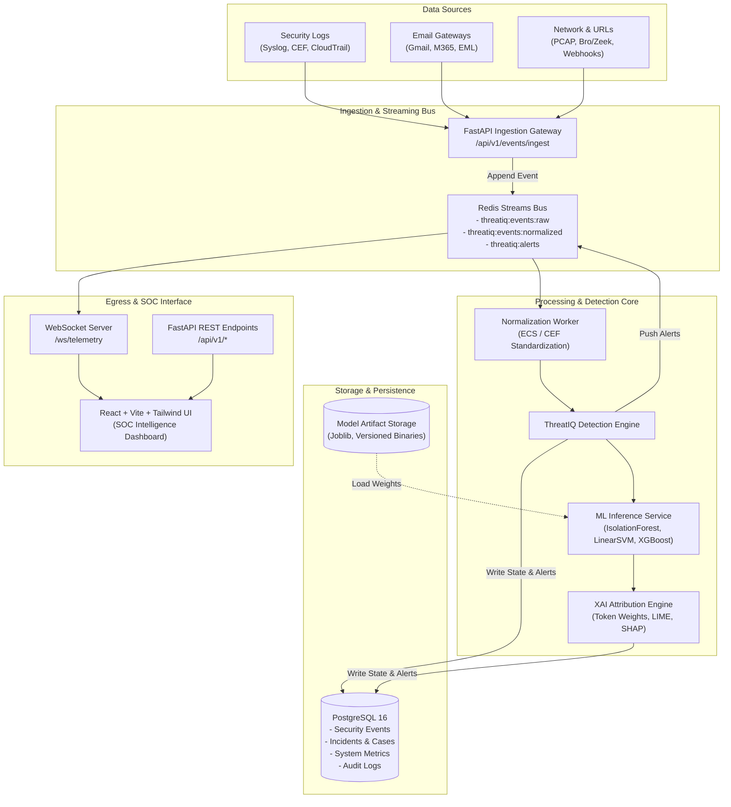

# ThreatIQ — System Architecture Specification

**Document Version:** 1.0.0  
**Phase:** Phase 0 (Foundation & Architecture)  
**Status:** Approved Baseline  
**Architecture Pattern:** Modular Monolith with Asynchronous Event Streaming  

---

## 1. Executive Architecture Summary

**ThreatIQ** is an enterprise-grade cybersecurity detection and Security Operations Center (SOC) intelligence platform. The architecture is engineered around the core philosophy of **explainable intelligence, high-throughput event processing, and human-in-the-loop triage**.

To maximize reliability and rapid iteration without premature distributed systems overhead, ThreatIQ is structured as a **Modular Monolith**. It cleanly isolates domain logic, separates offline ML training from real-time streaming inference, and leverages an event bus for asynchronous threat correlation.



---

## 2. Technology Stack & Decision Rationale

| Tier | Technology | Selected Version | Architectural Rationale |
|---|---|---|---|
| **Backend Core** | Python & FastAPI | Python 3.13 / FastAPI 0.110+ | Asynchronous ASGI framework with native OpenAPI schema generation and typed Pydantic validation. Ideal for ML integration. |
| **API Validation** | Pydantic v2 | Pydantic 2.6+ | High-performance C-extension validation engine with strict typing and serialization for telemetry events. |
| **Persistence** | PostgreSQL & SQLAlchemy | PostgreSQL 16 / SQLAlchemy 2.0+ | Relational integrity with JSONB capabilities for semi-structured security log attributes, indexed queries, and ACID compliance. |
| **Database Migrations** | Alembic | Alembic 1.13+ | Deterministic, version-controlled schema migrations preventing drift between development, testing, and production. |
| **Event Bus & Caching** | Redis Streams | Redis 7+ | Append-only log streaming with consumer groups, persistent offsets, sub-millisecond dispatch, and in-memory pub/sub. |
| **Real-time Push** | WebSockets | Native ASGI WebSockets | Bidirectional real-time telemetry streaming to SOC analyst dashboards without client polling. |
| **Machine Learning** | Scikit-learn, XGBoost, LIME | Scikit-learn 1.4+, LIME 0.2+ | Industry-standard tabular and NLP ML pipelines with transparent token attribution and explainability. |
| **Frontend Framework** | React + Vite | React 18 / Vite 5 | Fast HMR development, optimal production bundle splitting, and rich ecosystem for dashboard visualization. |
| **Styling & Design** | Tailwind CSS | Tailwind CSS 3.4+ | Utility-first CSS allowing rapid construction of cyber-defense dark-mode interfaces and consistent design tokens. |
| **Containerization** | Docker & Docker Compose | Docker Engine 24+ / Compose v2 | Isolated multi-service orchestration (Backend, Frontend, Postgres, Redis) ensuring identical local and production runtimes. |
| **Testing & CI** | pytest & GitHub Actions | pytest 8.1+ | Parameterized unit testing, integration verification, test isolation, and automated CI quality gates on git push. |

---

## 3. ThreatIQ 12 Target Modules Decomposition

```
+-----------------------------------------------------------------------------------+
|                           THREATIQ MODULAR PLATFORM                               |
+-----------------------------------------------------------------------------------+
|  1. Security Log Monitoring       | Ingests Syslog, CEF, JSON, CloudWatch events |
|  2. AI Anomaly Detection          | Unsupervised baseline deviation (IsolationForest) |
|  3. Phishing Protection           | Live Gmail/Outlook triage, RFC 822 parsing    |
|  4. Malicious URL Intelligence    | Passive defanging, domain reputation, TLD checks |
|  5. Cyber Risk Prediction         | Quantitative risk scoring across assets       |
|  6. Vulnerability Prioritization  | EPSS & CVSS threat contextualization          |
|  7. Explainable Threat Analysis   | Token attribution, feature importance, XAI    |
|  8. SOC Incident Management       | Case lifecycle, triage states, PDF export     |
|  9. AI Security Copilot           | Natural language SOC triage recommendations   |
| 10. Attack Path Visualization     | Graph-based MITRE ATT&CK kill chain mapping   |
| 11. Security Assumption Testing   | Posture validation against simulated attacks  |
| 12. Risk Investment Simulation    | ROI impact analysis of security investments   |
+-----------------------------------------------------------------------------------+
```

---

## 4. Ingestion & Event Processing Architecture

### 4.1 Ingestion Flow
1. **Producer Intake:** Security events arrive at `/api/v1/events/ingest` via HTTP POST or forwarder agents.
2. **Schema Validation:** Ingestion controller validates payload format against `RawSecurityEventSchema`. Payloads violating constraints are rejected with structured 422 errors.
3. **Stream Producer:** Validated payloads are written immediately to Redis Stream `threatiq:events:raw` with an auto-generated timestamped stream ID.
4. **Decoupled Processing:** The API client receives a `202 Accepted` response with the assigned event identifier in under 5ms.

### 4.2 Normalization & Enrichment
1. **Consumer Group:** A dedicated normalization worker group (`threatiq-normalizers`) reads batches from `threatiq:events:raw`.
2. **Schema Standardization:** Log attributes are mapped to the ThreatIQ Standard Schema (derived from Elastic Common Schema / ECS):
   - `@timestamp`, `event.id`, `event.category`, `event.severity`
   - `source.ip`, `source.port`, `destination.ip`, `destination.port`
   - `user.name`, `host.hostname`, `message`
3. **Enrichment:** IP classification (RFC 1918 private vs public), geo-lookup hints, and defanged IOC extraction.
4. **Normalized Stream:** Processed events are published to `threatiq:events:normalized`.

### 4.3 Detection & ML Inference
1. **Rule Matching:** High-speed deterministic rules match known signatures (e.g., brute force thresholds, known malicious hashes).
2. **ML Inference:** Feature vectors are generated and fed into specialized ML models (Anomaly Detection via Isolation Forest, Phishing via Calibrated SVM).
3. **Scoring:** Composite threat score is calculated (0–100 scale). Events exceeding threshold triggers (score >= 70) generate an Incident Alert.
4. **Alert Bus:** Alerts are appended to `threatiq:alerts` and persisted to PostgreSQL `security_events` table.
5. **Real-time Broadcast:** Connected SOC analyst WebSockets receive immediate alert notifications.

---

## 5. Security & Isolation Principles

1. **Non-Destructive Guarantee:** ThreatIQ is an intelligence and detection platform. It will **never** perform automated network blocking, firewall modification, asset termination, or destructive actions without explicit, multi-party manual authorization.
2. **Passive Threat Inspection:** Email and URL forensics operate strictly in passive mode. No outbound network requests are initiated to untrusted URLs or suspicious domains extracted from payloads.
3. **Role-Based Access Control (RBAC):** API endpoints enforce role separation:
   - `analyst`: Read telemetry, view cases, run ad-hoc scans.
   - `lead_analyst`: Change incident triage statuses, generate forensic reports.
   - `admin`: Manage system configuration and model deployments.
4. **Zero Hardcoded Secrets:** Configuration is strictly driven through environment variables loaded via Pydantic Settings. Database credentials, API tokens, and JWT secret keys are never committed to version control.
5. **Strict CORS & Host Protection:** Configurable trusted origins and trusted host middleware prevent cross-site request forgery and header spoofing.

---

## 6. Directory Layout & Modular Structure

```
ThreatIQ/
├── backend/
│   ├── app/
│   │   ├── api/
│   │   │   ├── v1/
│   │   │   │   ├── endpoints/
│   │   │   │   │   ├── health.py
│   │   │   │   │   ├── system.py
│   │   │   │   │   └── events.py
│   │   │   │   └── router.py
│   │   ├── core/
│   │   │   ├── config.py
│   │   │   ├── logging.py
│   │   │   └── security.py
│   │   ├── db/
│   │   │   ├── base.py
│   │   │   ├── session.py
│   │   │   └── init_db.py
│   │   ├── models/
│   │   │   ├── base.py
│   │   │   ├── system_metric.py
│   │   │   └── security_event.py
│   │   ├── schemas/
│   │   │   ├── health.py
│   │   │   ├── system.py
│   │   │   └── security_event.py
│   │   ├── services/
│   │   │   ├── system_service.py
│   │   │   └── event_pipeline.py
│   │   └── main.py
│   ├── alembic/
│   ├── tests/
│   ├── Dockerfile
│   └── requirements.txt
├── frontend/
│   ├── src/
│   │   ├── components/
│   │   ├── services/
│   │   ├── App.jsx
│   │   ├── main.jsx
│   │   └── index.css
│   ├── Dockerfile
│   └── package.json
├── docs/
│   ├── ARCHITECTURE.md
│   ├── ML_SPEC.md
│   └── PHISHGUARD_MIGRATION_AUDIT.md
├── docker-compose.yml
├── .env.example
├── ROADMAP.md
├── TASKS.md
├── PROGRESS.md
├── DECISIONS.md
├── AGENTS.md
└── README.md
```

